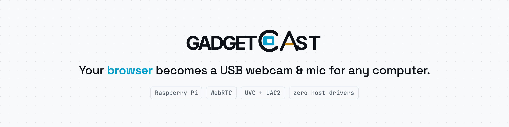
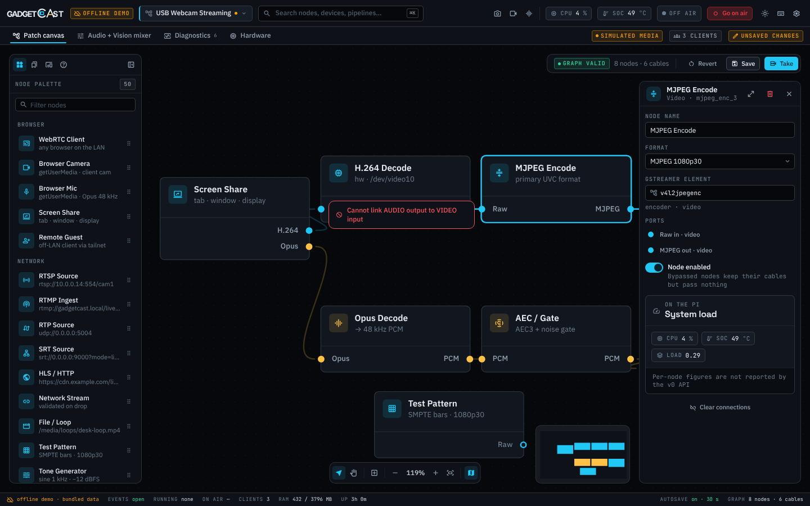

<p align="center">
  <picture>
    <source media="(prefers-color-scheme: dark)" srcset="docs/assets/banner-dark.png">
    
  </picture>
</p>

<p align="center">
  <a href="https://github.com/adeelahmad/gadgetcast/actions/workflows/ci.yml"></a>
  <a href="LICENSE"></a>
  
  
</p>

# gadgetcast

**AirPlay for USB peripherals: a Raspberry Pi that turns any browser on your network into a plug-and-play USB webcam, microphone and speaker for the computer it's plugged into.**

```console
curl -fsSL https://raw.githubusercontent.com/adeelahmad/gadgetcast/master/install.sh | sh
```

Open `https://gadgetcast.local` on your phone or laptop, share your camera, mic or a browser tab, and the host computer sees a normal UVC webcam and UAC2 headset. No drivers, no host software, no admin rights.

<p align="center">
  
</p>

## Why

- **Zero host footprint.** The host only ever sees class-compliant USB devices, so it works on locked-down corporate laptops, ChromeOS, smart TVs and anything else that accepts a USB webcam.
- **Any browser is a source.** Phone camera, a good mic on another machine, a remote guest over Tailscale, or a browser tab looped back as a "webcam".
- **Full duplex.** UAC2 is bidirectional, so the host's speaker output can flow back to the browser. It's an intercom, not just an injector.
- **A patch bay, not a black box.** GadgetCast Studio lets you wire sources, decoders, encoders and USB outputs on a canvas, switch what's on air, and watch CPU, SoC temperature and clients live.
- **Proven building blocks.** configfs composite gadgets (the same mechanism PiKVM ships), GStreamer / Pion for WebRTC, hardware H.264 decode and JPEG encode on the Pi 4.

## Install

**Flash a card (easiest).** Download `gadgetcast-*-arm64.img.xz` (Pi Zero 2 W, 3, 4, 5) or `gadgetcast-*-armhf.img.xz` (original Pi Zero / Zero W) from the [latest release](https://github.com/adeelahmad/gadgetcast/releases/latest), open it in [Raspberry Pi Imager](https://www.raspberrypi.com/software/) with "Use custom", set Wi-Fi in the customisation screen, flash and boot. The pairing PIN is in `gadgetcast-pin.txt` on the card's boot partition.

**Existing Raspberry Pi OS (or any Linux box).** Run the one-liner above. It installs the latest release, creates a TLS certificate and pairing PIN (printed at the end), enables USB gadget mode on a Pi (reboot once, or append `-s -- --reboot`), starts the service and turns on daily automatic updates. Options: `GADGETCAST_NO_AUTOUPDATE=1`, `GADGETCAST_VERSION=v0.1.0`, `--uninstall`.

**From source.**

```console
git clone https://github.com/adeelahmad/gadgetcast && cd gadgetcast
go test ./...
go run ./cmd/gadgetcast -dev -data ./data   # plain HTTP on 127.0.0.1:8080, PIN printed to the log
```

In production HTTPS is mandatory and the certificate, bind address and PIN source come from the JSON config: `gadgetcast -config /etc/gadgetcast/config.json -data /var/lib/gadgetcast`. Flags: `-config`, `-addr` (default `:8443`), `-data` (pipelines are stored as `<data>/pipelines/<id>.json`), `-dev`, `-version`. The REST, `/api/events` and `/ws` signaling API is documented in [docs/api.md](docs/api.md).

**Cutting a release** (maintainers): Actions → *Release* → *Run workflow* → type `v0.1.0`, or push a `v*` tag. Binaries, checksums, the installer and the Pi image are published to the release automatically.

## Quick start

> The end-to-end USB media path is still being built (see [Status](#status)). Today you can run the server and Studio UI, pair clients and build pipelines.

1. Plug the Pi's USB-C port (Zero 2 W: the inner micro-USB) into the host computer.
2. On any device on the same network, open `https://gadgetcast.local` and pair with the PIN.
3. Pick a pipeline (for example **Browser mic → USB mic**), grant mic, camera or screen-share permission, and press **Go on air**.
4. Select "GadgetCast" as the camera or microphone in Zoom, Teams, OBS or your browser on the host.

## How it works

```
 phone / laptop / remote guest            Raspberry Pi                          host computer
 ┌───────────────────────────┐   WebRTC   ┌─────────────────────────────────┐   USB    ┌──────────────────┐
 │ browser: mic, cam, screen │ ─────────▶ │ signaling + pairing (HTTPS/WSS) │ ───────▶ │ sees:            │
 └───────────────────────────┘            │ H.264 → decode → MJPEG  ─▶ UVC  │          │  USB webcam      │
                                          │ Opus  → PCM + drift ctl ─▶ UAC2 │ ◀─────── │  USB mic/speaker │
                                          └─────────────────────────────────┘          └──────────────────┘
```

Video arrives as H.264, is decoded (in hardware on a Pi 4) and re-encoded to MJPEG because USB 2.0 can't carry raw 1080p. Audio is decoded to 48 kHz PCM and passed through an adaptive resampler that tracks the drift between the browser's clock and the USB host's clock. The full design, constraints and prior-art survey are in [docs/design.md](docs/design.md).

## What it doesn't do

- **No host software, ever.** If your use case needs a virtual camera driver, use OBS.
- **Not for lip-sync-critical live performance.** Expect roughly 120 to 180 ms glass to glass.
- **USB 2.0 only.** The Pi's gadget controller is High-Speed, so video is MJPEG; raw YUYV tops out around 480p.
- **Not a KVM.** It's the mirror image of [PiKVM](https://pikvm.org): PiKVM takes the host's output to your browser, gadgetcast takes your browser to the host's input.

## Status

Early and moving fast. The Go core (signaling, pairing, session hub, on-air switcher, audio jitter buffer and clock-drift control) is built test-first with high coverage. The Pi server and GadgetCast Studio UI, the one-line installer and the flashable image are landing now. The end-to-end USB media path is the next milestone; see the [roadmap](docs/design.md#7-mvp-roadmap).

| Hardware | Target |
|---|---|
| Raspberry Pi 4B | Recommended: hardware H.264 decode and JPEG encode, 1080p30 |
| Raspberry Pi 5 | Software decode, 1080p30 with headroom |
| Raspberry Pi Zero 2 W | Host-powered "webcam on a stick", 720p target |
| Raspberry Pi Zero / Zero W | Server, pairing and Studio UI run (armv6 build, about 10 MB RAM); media path unproven on the single ARM11 core, low-resolution target |

Tried it on your hardware and host OS? A [hardware report](https://github.com/adeelahmad/gadgetcast/issues/new?template=hardware-report.yml) is one of the most useful things you can send.

## Security

This device is a network-controlled camera and microphone for whatever it's plugged into, so it ships locked down: HTTPS only, PIN pairing per client, an on-air indicator, and an option to listen on the Tailscale interface only. Please report vulnerabilities privately; see [SECURITY.md](SECURITY.md).

## Contributing

Issues, hardware reports and PRs are welcome. Start with [CONTRIBUTING.md](CONTRIBUTING.md).

## License

[MIT](LICENSE) © Adeel Ahmad
